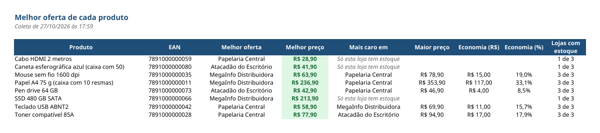
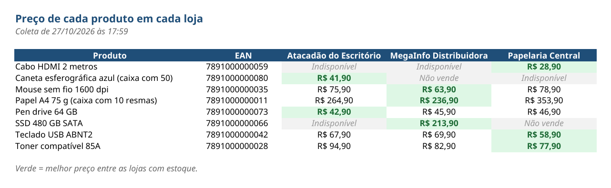
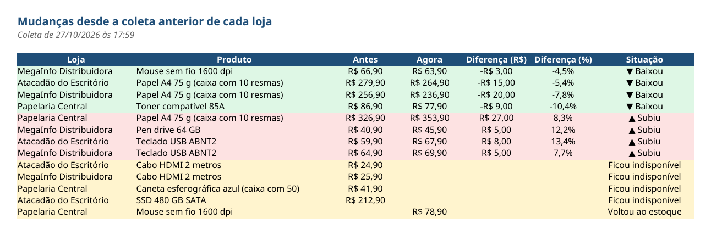
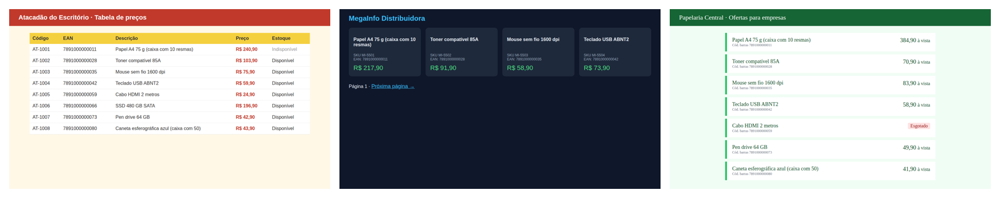

# Monitor de Preços de Fornecedores

Um robô que **visita o site de cada fornecedor, anota o preço e a disponibilidade de cada produto, guarda o histórico e entrega uma planilha Excel** com a melhor oferta, a comparação entre as lojas e o que subiu ou baixou desde a última coleta.



## O problema

Quem compra de vários fornecedores perde tempo abrindo site por site, copiando preços para uma planilha e comparando à mão. Quando o preço muda, ninguém percebe a tempo, e a empresa acaba pagando mais caro.

O robô faz essa pesquisa sozinho, do mesmo jeito que uma pessoa faria: abre cada site no navegador e lê o que está na tela.

## O que o robô entrega

Uma planilha só, `saida/relatorio_precos.xlsx`, atualizada a cada coleta:

| Aba | O que mostra |
|---|---|
| **Melhores ofertas** | Para cada produto: a loja mais barata, a mais cara e quanto se economiza, em R$ e em % |
| **Comparativo** | O preço de cada produto em cada loja, com o melhor em verde e o que está indisponível em cinza |
| **O que mudou** | O que subiu (vermelho), baixou (verde), acabou, voltou ao estoque ou saiu do site desde a coleta anterior |
| **Histórico** | O preço de cada produto em todas as coletas, para acompanhar a evolução |
| **Ocorrências** | Só aparece se algum site falhou: o motivo e o print da tela daquele momento |





## Os cuidados de um robô de verdade

| Situação | O que o robô faz |
|---|---|
| **Cada site mostra os produtos de um jeito** (tabela, cartões, lista) | Tem uma função de leitura para cada fornecedor. Para incluir um site novo, só se escreve a leitura dele |
| **Lista dividida em várias páginas** | Vai clicando em "próxima página" até o fim |
| **Preço escrito de formas diferentes** ("R$ 1.219,90", "32,90 à vista") | Converte tudo para número antes de comparar |
| **Produto sem estoque** | Anota como indisponível e não usa na comparação de preços |
| **Site fora do ar ou lento** | Tenta de novo até 3 vezes. Se continuar fora, tira um print, registra e **segue para o próximo fornecedor** |
| **O site mudou e o robô não achou nada** | Avisa que o layout pode ter mudado, em vez de gerar um relatório vazio |
| **Rodou várias vezes** | Cada coleta fica guardada no histórico (SQLite), sem duplicar produtos na mesma coleta |
| **Planilha aberta no Excel** | Avisa para fechar antes, em vez de perder o resultado |

Os mesmos produtos são reconhecidos em lojas diferentes pelo **código de barras (EAN)**, mesmo quando cada loja usa o seu próprio código.

Tudo fica registrado em `saida/monitor.log`, com data e hora.

## As lojas de demonstração

Para mostrar o robô sem visitar sites reais, o projeto traz **três fornecedores de mentira** que rodam só no seu computador, cada um com um visual e um jeito diferente de mostrar os produtos. Os preços mudam a cada vez que as lojas são ligadas, e a Papelaria Central sempre falha na primeira visita, para mostrar o robô tentando de novo.



Num trabalho real, o robô aponta para os sites dos fornecedores do cliente, e só as funções de leitura de cada site são adaptadas. Antes de começar, confere-se se o site permite a coleta e se exige login.

## Como rodar

O robô funciona no **Windows, Mac e Linux**. É preciso ter o [Python](https://www.python.org/downloads/) 3.10 ou mais novo instalado (no Windows, marque "Add python.exe to PATH" na instalação).

Depois, é só dar **dois cliques** no atalho do seu sistema:

| Sistema | Atalho |
|---|---|
| Windows | `rodar_monitor.bat` |
| Mac | `rodar_monitor.command` |
| Linux | `rodar_monitor.sh` |

Na primeira vez o atalho prepara tudo sozinho (leva alguns minutos). Nas próximas, só roda. Rode duas ou três vezes para ver a aba "O que mudou" e o histórico se encherem.

Para quem prefere o terminal:

```bash
python3 -m venv .venv
source .venv/bin/activate          # no Windows: .venv\Scripts\activate
pip install -r requirements.txt
playwright install chromium
python monitor.py --demo --mostrar # --demo liga as lojas; --mostrar abre o navegador
```

Para ver o robô lidando com um site fora do ar: `LOJAS_FORA=papelaria python monitor.py --demo`.

## Entrega para o cliente

- **Agendamento:** o robô pode rodar sozinho todo dia, ou várias vezes ao dia, pelo Agendador de Tarefas do Windows ou equivalente no Mac e no Linux.
- **Programa pronto:** pode ser entregue como um programa único (um `.exe` no Windows), sem precisar instalar o Python.
- **Próximos passos possíveis:** aviso quando um preço cair abaixo de um valor combinado, lista de produtos de interesse numa planilha, gráficos de evolução de preço.

## Estrutura

```
monitor-precos/
├── lojas/             as três lojas de demonstração
├── saida/             relatório, histórico (historico.db), log e prints de erro
├── monitor.py         o robô: visita as lojas e coleta os preços
├── historico.py       guarda as coletas e calcula o que mudou
├── relatorio.py       monta a planilha de relatório
├── rodar_monitor.*    atalhos de dois cliques (Windows, Mac, Linux)
└── requirements.txt   bibliotecas necessárias
```

## Tecnologias

Python, [Playwright](https://playwright.dev/python/) (controla o navegador), SQLite (histórico), openpyxl (planilha), Flask (lojas de demonstração).

## Sobre

Projeto de portfólio de **Gilmar Alberto de Abreu Pinto**, analista de sistemas em Curitiba, inspirado em pedidos reais de clientes. As lojas, os produtos e os preços são fictícios. Desenvolvido com apoio de IA (Claude).

**Precisa acompanhar preços de fornecedores ou concorrentes?** Me contrate pela plataforma que você já usa:

- [99Freelas](https://www.99freelas.com.br/user/GilmarAlberto)
- [Workana](https://www.workana.com/freelancer/1ccbe3135f7ebb6a82b57c41ea77d535)
